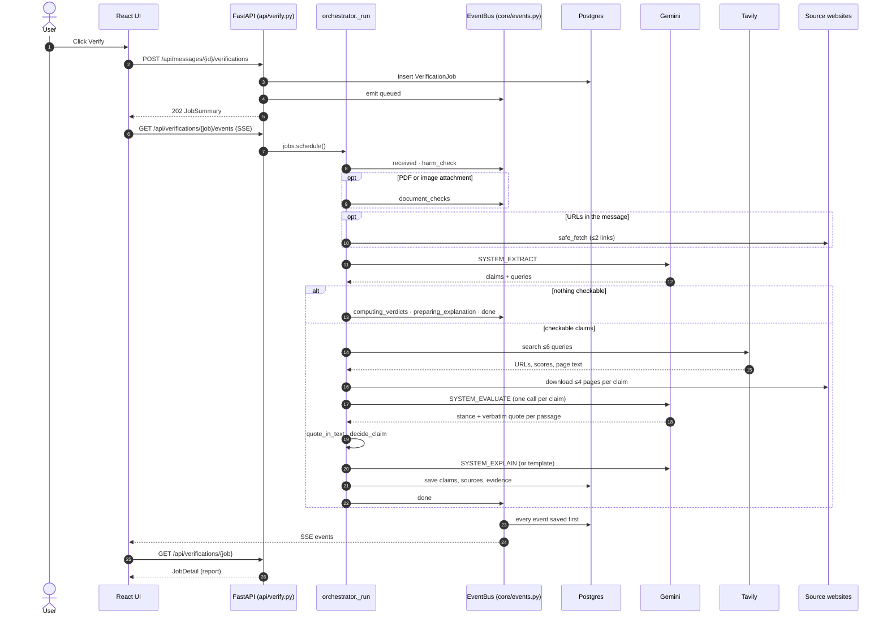
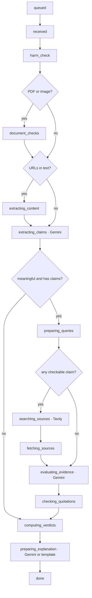

# SatyaSetu — Agent Investigation Timeline: Internal Architecture and Execution Flow

> Based on the SatyaSetu repository (`main` at `19ae4c0`). All file paths, functions and code snippets are taken
> from the actual source. Anything not implemented is labelled **proposed**.

## A. Introduction

**What the "investigation timeline" means here.** When a user clicks **Verify**, the backend runs one verification
job through a sequence of *stages*. Each stage is a concrete system action: run the safety rules, ask Gemini to
extract claims, search with Tavily, download pages, check quotes, apply verdict rules. Every stage reports when it
starts and when it finishes or fails. The ordered record of these events is the investigation timeline.

**Why it matters for SatyaSetu.** A fact-checker that only shows a final verdict asks users to trust it blindly. The
timeline shows that real work happened, in a real order:
- searches were made;
- pages were downloaded;
- some quotes were rejected;
- a rule produced the verdict.

**What it does not show.** It does not expose model "thinking". Gemini 3 models run with `thinkingLevel: low`, and any
thought parts in the response are discarded (`_extract_text` in `backend/app/providers/llm.py` skips parts with
`thought`). The timeline contains only observable system actions and their results.

## B. End-to-end execution flow

| # | Step | Always or conditional | Where |
|---|---|---|---|
| 1 | User sends text, or uploads an image, PDF or audio file | Always | `frontend/src/components/Composer.tsx` → `store.send` / `store.upload` |
| 2 | Input validated and stored as a message | Always | `backend/app/api/chat.py → send_message` / `upload_attachment` |
| 3 | Text extracted from the upload: OCR, PDF text, or audio transcription | Uploads only. Happens at upload time, before Verify. | `backend/app/ingest/extract.py` |
| 4 | User clicks **Verify**; quotas checked; job created | Always (user-triggered) | `MessageBubble.tsx → VerifyBar` → `api/verify.py → start_verification` |
| 5 | Job scheduled in the background | Always | `backend/app/core/jobs.py → schedule` |
| 6 | `received`, then `harm_check` (fixed rules) | Always | `pipeline/orchestrator.py → _run`, `pipeline/harm.py → assess` |
| 7 | `document_checks` (forensics) | Only for PDF or image attachments | `pipeline/forensics.py → analyse` |
| 8 | `extracting_content`: links in the message fetched | Only if the text contains URLs (first 2) | `core/safe_fetch.py → safe_fetch`, `retrieval.extract_page` |
| 9 | `extracting_claims`: **Gemini call** | Always | `llm.generate_json(SYSTEM_EXTRACT, ClaimExtraction)` |
| — | Early finish | If the text is meaningless or no statements are found | `_complete(..., note=...)` |
| 10 | `preparing_queries`: search plan built | Always after extraction | `_run` |
| 11 | `searching_sources`: **Tavily** | Only if at least one claim is checkable | `retrieval.search_claims`, `select_candidates` |
| 12 | `fetching_sources`: pages downloaded | Same condition | `retrieval.fetch_all` |
| 13 | `evaluating_evidence`: **Gemini call per claim** | Per checkable claim that has passages | `evaluate()` inside `_run` |
| 14 | `checking_quotations` | Always | `pipeline/text.py → quote_in_text` |
| 15 | `computing_verdicts` | Always | `pipeline/verdicts.py → decide_claim`, `decide_overall` |
| 16 | `preparing_explanation`: **Gemini call**, or a template | Always | `pipeline/explain.py → explain` / `template_explanation` |
| 17 | Everything saved in one transaction, then a `done` event | Always | `_complete` |
| 18 | Correction message drafted | **Separate and on demand.** The user clicks "Write a correction". | `api/verify.py → create_correction` → `pipeline/correction.py → draft_correction` |

Step 3 deserves a note. OCR, PDF reading and transcription run **when the file is uploaded**, not during the check. The
extracted text is stored on the attachment. `build_input()` then merges it with the caption when Verify is clicked:

```python
# backend/app/api/verify.py
def build_input(msg: Message) -> str:
    s = get_settings()
    parts = [msg.text.strip()] if msg.text.strip() else []
    if msg.attachment and msg.attachment.extracted_text:
        label = {"image": "Text read from image", "pdf": "Text from document",
                 "audio": "Transcript of audio"}.get(msg.attachment.kind, "Extracted text")
        parts.append(f"[{label}]\n{msg.attachment.extracted_text.strip()}")
    return "\n\n".join(parts)[: s.max_input_chars]
```

**Uploaded file types.** These are detected from the file's contents, not its extension
(`backend/app/ingest/extract.py → sniff`):

| Kind | Formats | How it's read |
|---|---|---|
| Image | PNG, JPEG, WebP | Tesseract OCR (`eng+hin+mar`), with a confidence score (`ocr_image`) |
| PDF | Any unencrypted PDF | Text layer first; pages with almost no text are OCR'd; first 20 pages only (`extract_pdf`) |
| Audio | WAV, OGG, MP3, M4A, WebM | `faster-whisper` (`transcribe`). **Disabled on production** (`WHISPER_ENABLED=false` in `render.yaml`), where uploads get HTTP 415 `audio_disabled` |

Video is rejected. A pasted URL isn't a separate input type: links inside text are fetched in the `extracting_content`
stage.

## C. Agent and tool interaction

**What Gemini does.** Gemini makes three kinds of call. Each must return JSON that matches a Pydantic model, enforced
through Gemini's `responseSchema` (`providers/llm.py → to_gemini_schema`).

1. **Claim extraction** (`ClaimExtraction`). It splits the message into statements and marks each as checkable or not.
   It extracts entities, dates, numbers and location, and writes 1–2 neutral search queries per claim.
2. **Evidence evaluation** (`EvidenceEvaluation`). For one claim, it labels every retrieved passage as supports,
   refutes, partially supports or not relevant, and copies a verbatim quote.
3. **Explanation** (`Explanation`). It writes the plain-language summary. The verdicts are already fixed when this call
   runs.

**What Tavily does.** It is a search tool and nothing else. It receives a query and returns URLs, titles, relevance
scores and the page text it extracted. Its AI answer is switched off (`"include_answer": False`), and it makes no
decisions.

**How the backend coordinates them.** `pipeline/orchestrator.py → _run()` calls everything in order. Gemini and Tavily
never talk to each other. The orchestrator takes Gemini's queries, sends them to Tavily, downloads the pages itself,
picks passages, and sends those back to Gemini in a separate call.

**Predefined or dynamic?** The *order of stages* is fixed in code. What happens inside the stages depends on the input
and on Gemini's output:
- **Gemini's output decides** how many claims exist, which are checkable (at most 4, harmful ones first), and what is
  searched.
- **The input decides** whether forensics runs (uploads only) and whether links are fetched (URLs present).
- **Work is skipped** when there's nothing to do. With nothing checkable, no search or fetching happens.

The orchestrator never asks the model which step to run next.

**Retries, failures and fallbacks:**

| Situation | What happens | Where |
|---|---|---|
| Gemini returns JSON that doesn't match the schema | The bad output and the error are sent back once for a corrected answer. A second failure ends the job with `invalid_model_output`. | `GeminiProvider._generate_with_model` |
| A temporary HTTP error (5xx, rate limit with a short delay) | One retry | `GeminiProvider._post` |
| The primary model's daily quota is used up | That model is skipped until midnight Pacific; the fallback model (`gemini-3.5-flash-lite`) is used | `generate_json`, `next_quota_reset` |
| A model is overloaded or times out | The fallback is tried, and the overloaded model rests for 5 minutes (`OVERLOAD_COOLDOWN_S = 300`) | `generate_json` |
| Some Tavily queries fail | The rest are used | `search_claims` |
| All Tavily queries fail | The real provider error ends the job | `search_claims: raise errors[0]` |
| A site blocks our download | Tavily's extracted text is used and labelled `provider_extract` | `fetch_source` |
| Time is running out before the explanation | The template explanation is used, keeping the verdict | `_complete`, `EXPLANATION_RESERVE_S = 15.0` |
| The whole check runs over 300 s | The job fails with `timeout` | `run_verification`, `check_timeout_s` |
| The server restarts mid-check | The job is marked `failed` / `interrupted` at startup | `jobs.mark_interrupted_jobs` |

The system never "changes its approach". For example, it never reformulates a search when the evidence is weak; it
reports **insufficient evidence** instead.

**What makes it agentic, and what doesn't.**
- **Agentic:** an LLM plans the content of the work (claims and queries) and judges the observations (passages). Real
  tools act on the world (web search, page download, OCR, forensics). The work is goal-directed, budgeted, and ends in
  a defined state.
- **Not agentic:** there is no loop that repeats until the goal is met. The model never picks tools. Stored history is
  never read back during a new check.

The accurate description is a **tool-using agentic workflow with LLM planning and deterministic decision rules**.

## D. Code mapping by stage

| Stage | File · function | Input | Processing | Output | Next |
|---|---|---|---|---|---|
| Job start | `api/verify.py → start_verification` | message id, `VerifyRequest{language, retry}` | Duplicate click → returns the existing job. `build_input`; `KeyedLimiter` (6/min/session); `enforce_check_quotas` (30/hour global, 15/day/session); insert `VerificationJob`; emit `queued` | `202 JobSummary` | `jobs.schedule` |
| Scheduling | `core/jobs.py → schedule` | job id | `asyncio.create_task` under a semaphore (`max_concurrent_checks = 3`) | background task | `run_verification` |
| Supervisor | `orchestrator.run_verification` | job id | Sets `_deadline`; `asyncio.wait_for(_run, 300)`; converts exceptions into a failed job | `completed` / `failed` job | — |
| `received` | `_run` | `job.input_text` | Detects script (`detect_script_language`) | event `"N characters"` | harm |
| `harm_check` | `harm.assess`, `risk_level` | text | Regex rules for OTP, payment, personal data, links, medical, impersonation, urgency, AI instructions | `job.harm` | forensics or links |
| `document_checks` | `forensics.analyse` | pages, PDF metadata | Date consistency, free-mail on official letters, editing software, reference and phone formats | `DocumentFinding` rows | links |
| `extracting_content` | `safe_fetch`, `extract_page` | ≤2 URLs | SSRF-safe download, text extraction | up to 3,500 chars per page appended for extraction | claims |
| `extracting_claims` | `llm.generate_json(SYSTEM_EXTRACT, ClaimExtraction)` | message text + linked text | Claim split; budget enforced (`max_claims_per_check = 4`) | `claims`, `message_language`, `ai_instruction_detected` | queries |
| `preparing_queries` | `_run` | claims | ≤2 queries per claim; `country="india"` if the location matches `INDIA_HINTS` or the script is Devanagari | `plan` | search |
| `searching_sources` | `retrieval.search_claims`, `select_candidates` | plan | Breadth-first; ≤6 searches; rank by tier weight + score; one page per domain; ≤4 per claim | `sources`, `raw` | fetch |
| `fetching_sources` | `retrieval.fetch_all` → `fetch_source` | sources | Up to 5 downloads at once; trafilatura / pypdf; provider-text fallback | `RetrievedSource.text`, `fetch_ok` | evaluate |
| `evaluating_evidence` | `evaluate()` in `_run` | claim + top-3 passages per source | `select_passages`; `SYSTEM_EVALUATE`; claims run in parallel (`asyncio.gather`) | stance + quote per passage | quotes |
| `checking_quotations` | `text.quote_in_text` | quote, passage, page | Must appear verbatim in **both** | `valid`, `rejected_reason` | verdicts |
| `computing_verdicts` | `verdicts.decide_claim`, `counted_mask`, `decide_overall`, `overall_strength` | evidence inputs | Weighted rules | verdict, strength, `weights` | explanation |
| `preparing_explanation` | `explain.explain` / `template_explanation` | verdicts, counted quotes, `[S#]` labels | Gemini explains fixed verdicts; `_clean` strips URLs and invalid labels | `job.explanation` | persist |
| Persist + `done` | `_complete` | everything | One transaction: sources, claims, evidence, job | event `done` | UI |

The `Stage` helper that produces the timeline:

```python
# backend/app/pipeline/orchestrator.py
class Stage:
    def __init__(self, job_id: uuid.UUID, name: str):
        self.job_id, self.name = job_id, name

    async def __aenter__(self) -> "Stage":
        self.detail: str | None = None
        self.skipped = False
        await bus.emit(self.job_id, "stage", self.name, "started")
        return self

    async def __aexit__(self, exc_type, exc, tb) -> bool:
        if exc_type is None:
            await bus.emit(self.job_id, "stage", self.name, "skipped" if self.skipped else "completed", self.detail)
        else:
            await bus.emit(self.job_id, "stage", self.name, "failed", _safe_error(exc))
        return False
```

Because "completed" is sent only when the block finishes without an exception, **a step is never shown as done before
the work is actually done**. `self.skipped` is never set to `True` anywhere, so "skipped" events don't occur in
practice.

Example of a stage using it (the search and fetch stages):

```python
        async with Stage(job_id, "searching_sources") as st:
            hits = await search_claims(plan, search, factcheck, stats)
            sources, raw = select_candidates(hits)
            st.detail = f"{sum(len(h) for h in hits.values())} result(s), {len(sources)} candidate page(s)"

        async with Stage(job_id, "fetching_sources") as st:
            await fetch_all(sources, raw, stats)
            ok = sum(1 for s in sources.values() if s.fetch_ok)
            st.detail = f"{ok} of {len(sources)} page(s) retrieved"
```

The supervisor that guarantees every job ends in a defined state:

```python
# backend/app/pipeline/orchestrator.py
async def run_verification(job_id: uuid.UUID) -> None:
    settings = get_settings()
    stats = CallStats()
    _deadline.set(time.monotonic() + settings.check_timeout_s)
    try:
        await asyncio.wait_for(_run(job_id, stats), timeout=settings.check_timeout_s)
    except asyncio.TimeoutError:
        await _fail(job_id, "timeout", f"The check did not finish within {int(settings.check_timeout_s)} seconds.", stats)
    except ProviderError as e:
        await _fail(job_id, e.code, str(e), stats)
    except Exception:
        log.exception("verification %s crashed", job_id)
        await _fail(job_id, "internal", "An unexpected error occurred. Please retry.", stats)
```

## E. Timeline visualisation



The stages as a flowchart, with conditions:



## F. How the backend and frontend connect

**1. Every event is saved, then pushed.** `EventBus.emit` (`backend/app/core/events.py`) writes a `VerificationEvent`
row (`job_id`, `seq`, `kind`, `stage`, `status`, `detail`, `created_at`). Only then does it put the event on live
subscribers' queues. Event kinds are `stage`, `done` and `error`.

**2. The SSE endpoint** is `GET /api/verifications/{job_id}/events` (`api/verify.py → stream_events`). It:
- replays saved events after `Last-Event-ID` (or `?after=`), then streams live ones;
- sends `retry: 3000` so the browser reconnects after 3 s, and a `: keep-alive` comment every 15 s;
- closes after `done` or `error`;
- if the job has already finished with no closing event (for example after a restart), sends a `status` event.

**3. The client** (`frontend/src/state/store.ts → stream`):
- **Connection:** opens an `EventSource` and listens for `stage`, `done`, `error` and `status`.
- **Merging:** combines events with `mergeEvents` (de-duplicated by event id).
- **Watchdog:** checks the job's real status every 30 s (`WATCHDOG_MS`).
- **Fallback:** if the browser closes the stream for good (for example a proxy returns an HTML 502), it switches to
  `pollUntilDone`, which polls every 4 s for up to 10 minutes.
- **Finish:** on `done` or `error`, it fetches the full report (`loadDetail` → `GET /api/verifications/{id}`).

**4. On screen:**
- `MessageBubble.tsx` shows the current step on the message (`data-testid="verify-progress"`).
- `DetailsPanel.tsx → Progress` lists every reported step with a tick, spinner or cross, its detail text and its time.
  Labels come from `frontend/src/lib/verdicts.ts → STAGES`.
- The list is shown **while a check is queued or running, and in the Failed view**.

**What is not implemented (proposed enhancements, not current features):**
- The finished report does **not** show the timeline. The events are available in `JobDetail.events`, but `Report`
  doesn't render them.
- Step durations aren't shown. `Progress` keeps only each step's latest event, so its start time is lost.
- Per-claim progress isn't reported: events are per stage, not per claim.
- The `fetching_sources` detail doesn't say how many pages came from Tavily's text because the site blocked our
  download.

## G. Current implementation vs possible improvements

| Area | Implemented today | Possible improvement (proposed) |
|---|---|---|
| Stage events | Saved, replayable, real start/finish/failure | Per-claim events for long multi-claim checks |
| Live progress UI | `Progress` while running and on failure | Same list in the completed report, with durations |
| Stage details | Short counts (results, pages, quote rejections) | Retrieval breakdown (direct vs search-provider text vs unavailable) |
| Iteration | One search round; insufficient evidence reported honestly | One bounded re-search round for insufficient claims |
| Memory | Everything saved per session for 30 days and shown in History | Reusing a recent verified result for the same normalized claim |

## H. Jury questions

1. **What is the "agent" in SatyaSetu?**
   `orchestrator.run_verification` / `_run`. It is a background job that uses Gemini as its reasoning component and
   Tavily, the safe downloader, extractors and forensics as tools, with the goal of an evidence-backed verdict for every
   checkable claim.

2. **Is this autonomous planning or a fixed pipeline?**
   The stage order is fixed. Planning is the model's: it decides what the claims are, which to check, and what to
   search. We chose this deliberately, because a fact-checker should be predictable and auditable.

3. **Is the progress real or an animation?**
   Real. `Stage.__aexit__` sends "completed" only after the work block finishes. Events are saved before they're
   pushed, and the UI shows only what the server sent.

4. **What if the connection drops mid-check?**
   The browser reconnects and resends `Last-Event-ID`, and the server replays the saved events. If the stream can't be
   used at all, the client polls, and a 30-second watchdog catches a stalled stream.

5. **What happens when Gemini runs out of quota?**
   A daily-quota 429 marks that model exhausted until midnight Pacific, and calls go to the fallback model. When both
   are exhausted, the job fails with `quota_exhausted`, and the message says when the quota resets.

6. **Does the agent search again if evidence is weak?**
   No. There is one search round of up to 2 queries per claim and 6 per check. It ends with "insufficient evidence"
   rather than guessing.

7. **How does the job end?**
   With a `done` event after everything is saved, or an `error` event with a specific code. There is a hard
   300-second limit, and 15 seconds are kept in reserve so a slow explanation can't cost the verdict.

8. **Do you expose chain-of-thought?**
   No. Thinking is set to low and any thought parts in the response are discarded. The timeline shows only system
   actions such as searches, downloads and quote checks.

9. **What happens after a server restart mid-check?**
   At startup, `mark_interrupted_jobs` marks running jobs `failed` with `interrupted`. The SSE endpoint reports that
   status, and the user can press Retry.

10. **How many checks can run at once?**
    Three per server process (`max_concurrent_checks`). Downloads run up to five at a time within a check.
