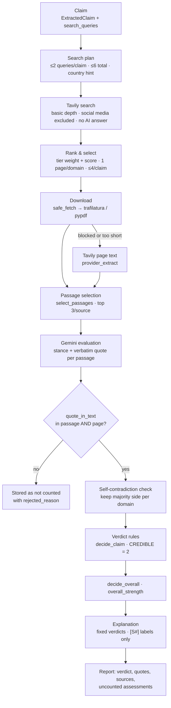

# SatyaSetu — Evidence Investigation and Transparency: Technical Architecture

> Based on the SatyaSetu repository (`main` at `19ae4c0`). All file paths, functions and code snippets are taken
> from the actual source. Anything not implemented is labelled **proposed**.

## A. Introduction

**The problem with an AI verdict alone.** A language model answering "is this true?" answers from its training data.
It can be out of date, and it can produce a confident answer or an invented citation that nobody can check.

**What SatyaSetu does instead.** It treats the model as a **reader**, not a judge:
1. Find real pages on the web.
2. Download them ourselves.
3. Give the model only selected passages from those pages.
4. Require it to copy the exact sentence that justifies each label.
5. Throw away any "quote" that isn't literally on the page.
6. Let fixed rules, not the model, turn the surviving quotes into a verdict.

Every verdict can therefore be traced to: claim → quote → source page.

**Practical example.** For "Drinking hot water with lemon cures cancer, doctors confirm.", the live evaluation run of
2026-10-10 returned **false** in 40.5 s. The verdict came from refuting quotes that were found verbatim in the
downloaded pages and weighted by source type, not from the model's own opinion.

## B. Search and retrieval

**1. Query generation.** The extraction prompt (`backend/app/pipeline/llm_io.py → SYSTEM_EXTRACT`) asks Gemini for:

> "search_queries: specific, neutral queries that would find primary sources or fact-checks. Include key names,
> numbers, dates and issuing authority. Use English; you may add one query in the message's language. Do not
> presuppose the answer (no "fake"/"hoax" in queries)."

The queries are a field of `ExtractedClaim` (`search_queries: list[str]`) and are saved with each claim
(`Claim.queries` in `backend/app/models.py`).

**2. The search plan.** In `pipeline/orchestrator.py → _run` (`preparing_queries`), each checkable claim gets up to
`max_searches_per_claim = 2` queries. A country hint is added like this:

```python
            loc = (c.location or "").lower()
            india = any(h in loc for h in INDIA_HINTS) or content_meta["script"] == "devanagari"
            qs = [q.strip() for q in c.search_queries if q.strip()][: settings.max_searches_per_claim]
            plan.append((i, qs, "india" if india else None))
```

`pipeline/retrieval.py → search_claims` runs the plan **breadth-first**: every claim gets its first query before any
claim gets a second. The total is capped at `max_total_searches_per_check = 6`:

```python
    for round_ in range(s.max_searches_per_claim):  # breadth first: every claim gets its first query
        for idx, queries, country in claims:
            if round_ < len(queries) and len(plan) < budget:
                plan.append((idx, queries[round_], country))
```

**3. The Tavily call** (`backend/app/providers/search.py → TavilySearch.search`):

```python
        body = {
            "query": query[:380],
            "search_depth": "basic",  # 1 credit
            "max_results": 6,
            "include_raw_content": "text",
            "include_answer": False,  # the provider's own AI answer is never used as evidence
            "exclude_domains": EXCLUDED_DOMAINS,
        }
```

`EXCLUDED_DOMAINS` covers social and user-generated platforms: Facebook, Instagram, X/Twitter, TikTok, Pinterest,
Quora, Reddit, ShareChat, Telegram, WhatsApp, LinkedIn. Before each call, the code checks our own budgets: 40
searches/day, 900/month, and 30/minute (`core/usage.py → ensure_daily_budget`, `get_month_count`, `MinuteLimiter`).
Error mapping:

| Tavily response | Error raised |
|---|---|
| 429 | `RateLimited` |
| 432 or 433 | `QuotaExhausted` |
| 401 or 403 | Bad API key |
| 5xx | Retryable `ProviderError` |

**4. Optional fact-check lookup.** If `FACTCHECK_API_KEY` is set, `GoogleFactCheckSearch` adds reviews from Google's
Fact Check Tools API. Those sources get the tier `fact_check`. The key is empty in the local `.env`; check the Render
environment before claiming this is used in production.

**5. Result processing and source selection** (`retrieval.select_candidates`). For each claim, hits are ranked, then
filtered:

```python
        ranked = sorted(hits, key=lambda h: rank_key(classify(h.url), h.score), reverse=True)
        ...
            if dom in seen_domains or picked >= s.max_sources_per_claim:
                continue  # one page per domain per claim -> independent sources
```

- **Ranking:** `rank_key = TIER_WEIGHT[tier] + Tavily score`.
- **Filtering:** one page per domain per claim, at most `max_sources_per_claim = 4`.
- **Kept for later:** Tavily's `raw_content` is stored in `raw[url]`, used only if our own download fails.

**6. Source credibility tiers** (`backend/app/pipeline/sources.py → classify`, `TIER_WEIGHT`):

| Tier | Weight | Examples (from the lists in code) |
|---|---|---|
| `official` | 3 | `.gov.in`, `.nic.in`, `.gov`, `rbi.org.in`, `who.int`, `isro.gov.in`, `nta.ac.in` |
| `fact_check` | 3 | `altnews.in`, `boomlive.in`, `factly.in`, `snopes.com`; any URL path containing `/fact-check` |
| `news` | 2 | `thehindu.com`, `indianexpress.com`, `reuters.com`, `bbc.com` |
| `reference` | 2 | `wikipedia.org`, `britannica.com`, `nature.com`, `pubmed.ncbi.nlm.nih.gov` |
| `other` | 1 | Everything else, including `.ac.in` / `.edu` unless explicitly listed |

The tier describes the **kind of publisher, not whether it's right**, as the module's docstring says.

**7. Downloading pages** (`retrieval.fetch_source`, run up to 5 at a time by `fetch_all`):
- **Safe download:** `core/safe_fetch.py → safe_fetch` blocks private and loopback IPs, cloud metadata hosts, and
  DNS-rebinding tricks (it pins the resolved IP). It re-checks redirects, allows only HTML, plain text and PDF, and
  enforces a 10 s timeout and a 3 MB limit.
- **Content extraction:** `extract_page` reads HTML with `trafilatura` (main text, tables, metadata: title, date, site
  name), PDFs with `pypdf` (first 40 pages), and plain text as-is.
- **Acceptance:** at least 200 characters of text are required. Otherwise the page is marked "too little extractable
  text".
- **Fallback:** if the download fails or the text is too short, Tavily's text is used if it has 200+ characters
  (`retrieval_method = "provider_extract"`). Otherwise the source is saved with `fetch_ok = False` and the
  `fetch_error` reason.
- **Storage:** stored text is capped at 120,000 characters (`MAX_STORED_TEXT`). A SHA-256 of the text is kept
  (`content_sha256`).

```python
# backend/app/pipeline/retrieval.py → fetch_source (fallback part)
    if not src.fetch_ok and raw_fallback and len(raw_fallback.strip()) >= 200:
        # The site blocked or failed our direct fetch, but the search provider retrieved the page.
        src.text = raw_fallback[:MAX_STORED_TEXT]
        src.retrieval_method = "provider_extract"
        src.fetch_ok = True
```

**8. Search errors.** A single failed query is tolerated. If **every** query fails, the first real error is raised and
the job fails with that code. No substitute results are ever produced.

## C. How Gemini evaluates evidence

**1. Choosing passages** (`backend/app/pipeline/text.py → select_passages`). Each downloaded page is split into chunks
of about 700 characters (`split_passages`). Each chunk is scored by how many claim terms it contains:
- **Claim terms** are tokens from the normalized claim, its entities and its numbers.
- **Rare terms count more:** `idf = 1 + n/(1+df)`.
- **Terms with digits count double.**
- **Long chunks are slightly penalised:** the score is divided by `1 + len/2000`.
- **Selection:** the top 3 chunks with a score above 0 are kept per source.

This is lexical scoring, not embeddings.

**2. Building the prompt.** Each passage is numbered (`P1`, `P2`, …) and wrapped as untrusted data with its publisher
and date:

```python
            body = "\n\n".join(
                wrap("untrusted_passage", p, id=pid, publisher=s.publisher or s.domain,
                     date=s.published_date or "unknown")
                for pid, s, p in numbered)
            result = await llm.generate_json(
                system=SYSTEM_EVALUATE.format(today=today),
                prompt=f"CLAIM: {c.normalized_claim}\n(Original wording: {c.original_text})\n\n{body}",
                out=EvidenceEvaluation, stats=stats,
            )
```

`wrap()` neutralises any attempt by the content to close the tag early, so a web page can't break out of its
"untrusted" box.

**3. What the model returns** (`PassageAssessment` in `llm_io.py`):

| Field | Meaning |
|---|---|
| `passage_id` | Which passage is being labelled |
| `stance` | `supports`, `refutes`, `partially_supports` or `not_relevant` |
| `quote` | One or two sentences copied exactly from the passage; null if not relevant |
| `rationale` | Short reason for the label |
| `describes_past_state` | True if the claim was once true but has changed |
| `missing_context` | Context the claim omits that changes its meaning |

The response also includes `what_would_change`, and every field is validated against the schema.

Key rules in `SYSTEM_EVALUATE`:
- "Judge ONLY from the passage text. Do not use outside knowledge to fill gaps."
- Topical overlap or background facts are `not_relevant`.
- "Absence of information is not refutation."

**4. How the backend uses the answer.** Assessments are matched back to their passages by id. Any assessment with an
unknown id is dropped and logged. The labels then go through quote validation (D) and the verdict rules (E). **The
model's labels alone never decide the verdict.**

## D. Quote validation

**The check** (`backend/app/pipeline/text.py`):

```python
def normalize_for_match(s: str) -> str:
    s = unicodedata.normalize("NFKC", s).translate(_QUOTES)
    s = _WS.sub(" ", s).strip().lower()
    return s.strip(" .,;:\"'")


def quote_in_text(quote: str, text: str) -> bool:
    """A quote is valid only if it appears verbatim (modulo whitespace, typographic
    quotes and case) in the retrieved text."""
    q = normalize_for_match(quote)
    if len(q) < 12 or len(q.split()) < 3:
        return False
    return q in normalize_for_match(text)
```

**Where it's applied** (`orchestrator._run → checking_quotations`):

```python
                quote = a.quote.strip() if a.quote else None
                valid = bool(quote) and quote_in_text(quote, passage) and quote_in_text(quote, src.text)
                reason = None
                if a.stance != "not_relevant" and not valid:
                    rejected += 1
                    reason = "quote not found verbatim in the retrieved source text" if quote else "no quote given"
```

What this means:
- **Two checks:** a quote must appear in **both** the passage shown to the model and the full downloaded page.
- **What's tolerated:** only differences in whitespace, curly versus straight quotes, letter case, Unicode form, and
  punctuation at the ends.
- **What's rejected:** a paraphrase, a quote of fewer than 3 words or 12 characters, and a missing quote, each with a
  stored reason.
- **Not shown as evidence:** a rejected quote never counts toward a verdict. Passages that are both `not_relevant` and
  invalid aren't stored as evidence at all.

**Pages with no usable content.** A page that failed to download and has no fallback text has `fetch_ok = False`. It
contributes no passages, so it can't support anything. It is still listed among the sources with its error.

**Why this matters.** The most dangerous failure of an AI fact-checker is a convincing but invented citation. This
check makes that structurally impossible for counted evidence. The October live evaluation re-checked all 94 counted
quotes against the page text stored in Postgres, and all 94 were found.

One limit remains: a model could quote a real but irrelevant sentence with the wrong stance. That quote is real and
shown to the user, and each website counts only once, but the check can't detect it.

**Tests that enforce this:** `backend/tests/test_text_and_sources.py`
(`test_quote_verbatim_with_typographic_quotes_and_case`, `test_quote_paraphrase_rejected`,
`test_quote_too_short_rejected`) and `backend/tests/test_api_flow.py → test_paraphrased_quote_is_rejected`.

## E. Verdict generation

**1. Inputs.** For each assessment, the orchestrator builds an
`EvidenceInput(stance, quote_valid, tier, domain, temporal_issue, missing_context)`.

**2. Self-contradicting sources** (`verdicts._resolve_self_contradictions`). If one website has counted quotes on both
the supporting and refuting sides, only its majority side is kept. On a tie, it is dropped from both sides. This came
from a real case: Wikipedia's RBI article says "1934" in one sentence and "1 April 1935" in another.

**3. Weighting** (`_side_weight`). Each website counts **once per side**, with its tier weight. A side is **credible**
at weight ≥ `CREDIBLE = 2`. That means one official, fact-check, news or reference source, or two independent "other"
sites.

**4. The rules, in this exact order** (`backend/app/pipeline/verdicts.py → decide_claim`):

```python
    if not counted:
        return ClaimDecision("insufficient_evidence", "none", ...)
    if S >= CREDIBLE and R >= CREDIBLE:
        return ClaimDecision("conflicting", ...)
    if T >= CREDIBLE:
        return ClaimDecision("outdated", ...)
    if R >= CREDIBLE:
        return ClaimDecision("false", ...)
    if S >= CREDIBLE or P >= CREDIBLE:
        if C >= CREDIBLE:
            return ClaimDecision("misleading", ...)
        if S >= CREDIBLE:
            return ClaimDecision("verified", ...)
        return ClaimDecision("partly_true", ...)
    return ClaimDecision("insufficient_evidence", "weak", ...)
```

In this code:
- `S`, `R` and `P` are the supporting, refuting and partial weights.
- `T` is the weight of evidence marked "describes a past state".
- `C` is the weight of supporting or partial evidence that flags missing context.
- Claims that aren't checkable get `not_checkable` before any of this runs.

The numbers the rules used are saved alongside each verdict:

```python
    weights = {"supports": S, "refutes": R, "partial": P, "temporal": T, "missing_context": C,
               "counted": len(counted), "considered": len(evidence),
               "self_contradictory_domains": contradictory}
```

**5. Claim verdicts.** There are eight, and these are all of them: `verified`, `false`, `partly_true`, `misleading`,
`outdated`, `conflicting`, `insufficient_evidence`, `not_checkable`.

**6. The overall verdict** (`decide_overall`):
- If no claim is checkable, the result is `not_checkable`.
- If every checkable claim has the same verdict, that's the overall verdict.
- Otherwise it is `mixed`.

**7. Evidence strength.** It's a label, never a percentage (`_strength`):

| Strength | Condition |
|---|---|
| `none` | Nothing counted |
| `weak` | The winning side is below credible |
| `strong` | Weight ≥ 4 from ≥ 2 independent websites |
| `moderate` | Anything else credible |

The overall strength is the **weakest** of the checkable claims' strengths (`overall_strength`).

**8. Recording what counted.** `counted_mask` mirrors `decide_claim`, so each saved `Evidence` row has
`counted = True/False`, and a reason when a valid quote was excluded ("Excluded: this source contradicts itself on this
claim"). The numbers the rules used are saved in `Claim.weights`.

**9. After the verdict:**
- **Citation labels:** `[S1]`, `[S2]` … are assigned only to sources that contributed counted evidence.
- **Explanation:** `explain()` gets the fixed verdicts and counted quotes, and `_clean` removes URLs and any `[S#]` label
  that doesn't exist. If the model fails or time runs short, `template_explanation` builds the text from the findings.
- **Correction drafting** (`pipeline/correction.py → validate`) rejects a draft if:
  - its stated verdict doesn't match;
  - it contains a number that isn't in the message, claims or counted quotes;
  - it contains a URL;
  - it says "false/fake" when the verdict was insufficient, conflicting or not checkable.

**Tests that enforce the rules:** `backend/tests/test_verdicts.py` (19 tests, including
`test_no_evidence_is_insufficient_not_false`, `test_same_domain_counts_once`, `test_conflicting_when_both_sides_credible`
and `test_rbi_1935_self_contradictory_source_is_not_a_conflict`). `backend/tests/test_no_demo_paths.py →
test_verdicts_only_decided_by_rules` scans the code to prove that verdicts are set only by these rules.

## F. Code map

| Operation | File · function | Input → output | Next |
|---|---|---|---|
| Query generation | `pipeline/llm_io.py → SYSTEM_EXTRACT`, `ExtractedClaim.search_queries` | message → queries | plan |
| Search plan | `pipeline/orchestrator.py → _run` (`preparing_queries`) | claims → `(idx, queries, country)` | search |
| Search | `pipeline/retrieval.py → search_claims` → `providers/search.py → TavilySearch.search` | plan → `SearchHit`s per claim | select |
| Source selection | `retrieval.select_candidates`, `sources.classify`, `rank_key` | hits → `RetrievedSource`s + raw text | fetch |
| Download + extraction | `retrieval.fetch_all` → `fetch_source` → `core/safe_fetch.py → safe_fetch`, `extract_page` | sources → text, `fetch_ok`, `retrieval_method` | passages |
| Passage selection | `pipeline/text.py → select_passages` | page text + claim terms → top 3 passages | evaluate |
| Evaluation | `evaluate()` in `_run`, `SYSTEM_EVALUATE`, `EvidenceEvaluation` | claim + passages → stance + quote | validate |
| Quote validation | `text.quote_in_text` | quote → valid / rejected reason | rules |
| Verdict | `pipeline/verdicts.py → decide_claim`, `counted_mask`, `decide_overall`, `overall_strength` | evidence → verdict, strength, weights | explanation |
| Storage | `_complete` → `Source`, `Claim`, `Evidence` rows (`backend/app/models.py`) | results → database | API |
| API | `api/verify.py → job_detail` (`GET /api/verifications/{id}`) | job → `JobDetail` (`ClaimOut.evidence`, `SourceOut` with `label`) | UI |

## G. Evidence transparency in the UI

**1. Already implemented** (`frontend/src/components/DetailsPanel.tsx`):

| Feature | Component | What it shows |
|---|---|---|
| Report header | `Report` | Overall verdict, explanation of the verdict, evidence strength (bars), claims count, "sources checked" (fetched / total) |
| Summary notes | `Report` | Summary, uncertainty, missing context, what would change the result. Template explanations are labelled. |
| Each claim | `ClaimCard` | Original wording, "Checked as" (normalized form), verdict, strength, rule reason, conflict note, missing context |
| Counted quotes | `EvidenceItem` | Stance, "dated" flag, `[S#]` label, publisher, the quote, the model's reason, "Open source" link, "Quote verified against the retrieved page text" |
| Uncounted quotes | `ClaimCard` (collapsible) | "N assessment(s) not counted": the stance, domain, `rejected_reason`, and the struck-through quote |
| No evidence | `ClaimCard` | "No retrieved source contained a verifiable passage addressing this claim. That is not evidence that it is false." |
| Sources | `SourceRow` | Label, tier, domain, title link, "Retrieved directly / via search provider", time, or "Not used – {fetch_error}"; published date; fact-check rating |
| Usage | `Meta` | Models used, LLM calls, searches, pages fetched, linked-page outcomes, AI-instruction notice |

**2. Could be improved** (the data is already in the API response):
- **The rule's numbers.** `ClaimOut.weights` (supporting, refuting and partial weight, counted versus considered,
  self-contradicting websites) is never displayed. Showing it would explain *why* a verdict was reached.
- **Source type on each quote.** `EvidenceItem` doesn't show the source's tier, which sets each quote's weight. It's
  only visible in the sources list.
- **Source-to-claim mapping.** `SourceRow` doesn't say which claim a source was found for, or why a fetched source
  contributed nothing.
- **Fallback text.** Quotes based on Tavily's text rather than our own download carry the same "verified" note. It
  doesn't say the live page may differ.

**3. Proposed only (not built):**
- A link that opens the source page at the quoted sentence (`#:~:text=`).
- An explanation of why each source was considered relevant, such as its search score and the matched terms.

## H. Diagram



## I. Current implementation vs possible improvements

| Area | Implemented today | Possible improvement (proposed) |
|---|---|---|
| Retrieval | Live web search + direct download + provider-text fallback | One bounded re-search round when evidence is insufficient |
| Passage selection | Lexical, IDF-weighted, numbers boosted | Semantic ranking with embeddings for long pages |
| Credibility | Hand-maintained tier lists | Broader curated lists; per-claim-topic authority |
| Quote check | Verbatim in passage and page | Unchanged: this is the core trust mechanism |
| UI transparency | Quotes, rejected quotes, sources, retrieval method | Rule weights, tier on each quote, deep link to the quote |

## J. Jury questions

1. **Why not just let Gemini decide whether a claim is true?**
   The model's memory can be out of date and it can invent citations. In SatyaSetu it only labels passages it was given
   and must quote them; fixed rules decide. The same evidence always gives the same verdict.

2. **How do you know a quote is real?**
   `quote_in_text` requires it to appear verbatim in both the passage and the downloaded page, allowing only whitespace,
   case and quote-mark differences. Paraphrases are rejected and shown as "not counted".

3. **What stops three copies of one article from looking like strong evidence?**
   `select_candidates` keeps one page per domain per claim, and `_side_weight` counts each domain once per side.

4. **How is credibility decided? Isn't a domain list biased?**
   An explicit tier list in `sources.py`. It's transparent and auditable, unlike a learned score. The weakness:
   reputable sites we haven't listed count as "other" (weight 1).

5. **What if no source mentions the claim?**
   "Insufficient evidence", shown as "could not confirm". The prompt says absence of information isn't refutation, and
   correction drafts may not call the message false.

6. **How do you handle sources that disagree?**
   If both sides reach credible weight, the verdict is "conflicting" and the report says credible sources disagree. A
   single page that contradicts itself keeps only its majority side.

7. **What happens when a site blocks your download?**
   Tavily's extracted text is used if it has at least 200 characters, labelled "via search provider". Otherwise the
   source is listed as "Not used" with its error. In the live run, 36 of 94 counted quotes came from Tavily's text.

8. **Can a malicious web page change your verdict?**
   Page text is wrapped as untrusted data, and the model is told to ignore instructions inside it. Even if a label were
   manipulated, the quote still has to exist and the rules still decide.

9. **Why lexical passage selection instead of embeddings?**
   No extra model or vector store is needed, it runs instantly on a free server, and boosting numbers fits claims full
   of figures and dates. The limitation: on long pages it can miss a relevant paragraph that uses different wording,
   which pushes results toward "insufficient evidence".

10. **Does Tavily's AI answer ever count as evidence?**
    No. `include_answer` is false, and search snippets are never used. Only text from pages (downloaded, or Tavily's
    page text as a labelled fallback) is quoted.
