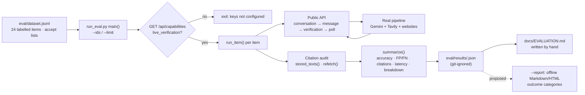
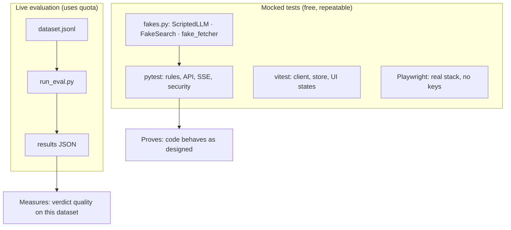

# SatyaSetu — Verification Evaluation Dashboard: Reliability, Testing and Performance

> Based on the SatyaSetu repository (`main` at `19ae4c0`). All file paths, functions and code snippets are taken
> from the actual source. Anything not implemented is labelled **proposed**.

**Status note: there is no evaluation dashboard in the codebase today.** Evaluation runs from a script, and its results
are saved as JSON files. Section E describes a possible dashboard and labels every part of it as proposed.

## A. Introduction

**Why evaluation matters.** A fact-checker that is wrong is worse than none: it gives false confidence. A demo shows
that the system *runs*, on a few chosen inputs. It doesn't show *how often it's right* on inputs nobody chose in
advance.

**Software testing vs quality evaluation:**

| | Software testing | Verification-quality evaluation |
|---|---|---|
| Question | Does the code do what it's designed to do? | Are the verdicts correct on real claims? |
| Providers | Mock Gemini and Tavily (`backend/tests/fakes.py`) | Real Gemini and Tavily |
| Repeatable? | Fully | No. The web and model outputs change. |
| Cost | Free, seconds | Uses free-tier quota, minutes |
| Proves | Rules, plumbing, failure handling, security | Real-world accuracy, for the dataset tested |
| SatyaSetu files | `backend/tests/`, `frontend/src/test/`, `frontend/e2e/` | `eval/dataset.jsonl`, `eval/run_eval.py` |

Passing the mocked tests says **nothing** about accuracy. The README says the same: "Mocked-provider tests prove the
plumbing and the rules, not verification quality."

## B. The existing evaluation setup

**1. The dataset** (`eval/dataset.jsonl`, 24 items). Each line is one JSON object:

```json
{"id": "f01", "lang": "en", "category": "false", "text": "Drinking hot water with lemon cures cancer, doctors confirm.", "accept": ["false", "misleading"]}
```

- `accept` lists **every verdict we consider defensible**, not just one "right answer". For example, the RBI scam item
  (`g01`) accepts `["false", "insufficient_evidence"]`, because "could not confirm" is honest when no source addresses
  the rumour.
- **Languages:** 20 English, 2 Hindi, 2 Marathi.
- **Categories:**

| Category | Items | Category | Items |
|---|---|---|---|
| true | 6 | partly_true | 1 |
| false | 6 | missing_context | 1 |
| govt_public_service | 2 | govt_scam | 1 |
| health | 2 | fabricated_quote | 1 |
| insufficient | 2 | manipulated_statistic | 1 |
| | | opinion | 1 |

**2. The runner** (`eval/run_eval.py`). `run_item` sends each item through **the same public API the UI uses**:
1. `POST /api/conversations`, then `POST /api/conversations/{id}/messages`.
2. `POST /api/messages/{id}/verifications`.
3. Poll `GET /api/verifications/{id}` every 2 s, for up to 300 s.

Then it records `status`, `error_code`, `verdict`, `latency_s`, `usage`, `models` and claim verdicts, plus
`correct = verdict in accept`:

```python
# eval/run_eval.py → run_item
    out = {"id": item["id"], "lang": item["lang"], "category": item["category"], "accept": item["accept"],
           "status": d["status"], "error_code": d.get("error_code"), "verdict": d.get("overall_verdict"),
           "latency_s": latency, "usage": d.get("usage"), "models": d.get("models_used"), "job_id": d["id"],
           "claims": [{"text": cl["original_text"], "verdict": cl["verdict"], "checkable": cl["checkable"]} for cl in d.get("claims", [])]}
    if d["status"] != "completed":
        return out
    out["correct"] = d["overall_verdict"] in item["accept"]
```

**3. The citation audit** (`run_item`). For every counted quote, it records:
- `quote_valid_server`: the server's own check;
- `quote_in_stored_text`: an **independent re-check** against the page text stored in Postgres. This only runs inside
  the backend container with `EVAL_DB=1`, via `stored_texts()`.
- `http_status_now`: whether the source URL still loads (`refetch()`);
- `quote_in_live_page`: whether the quote is still on the live page today.

**4. The summary** (`summarize`) and output. The script prints one line per item and a JSON summary. It saves
`eval/results/<YYYYMMDD-HHMMSS>.json` (`{"summary": …, "results": […]}`). `eval/results/*.json` is **git-ignored**, so
results stay on the machine that ran them.

**5. How to run it** (from the docstring). It uses real quota:

```powershell
docker compose run --rm -e EVAL_DB=1 -v ${PWD}/eval:/eval backend python /eval/run_eval.py --base http://frontend
#   --ids t01,f02   subset        --limit 1   smoke test
```

It exits early if `GET /api/capabilities` reports `live_verification: false`, meaning the keys aren't configured.

**6. The existing report** (`docs/EVALUATION.md`). It documents one live run (2026-10-10), marked **PARTIAL**, with
these real numbers from `eval/results/20261010-153644.json`:

| Metric | Value |
|---|---|
| Completed | 20 of 24; the 4 Hindi/Marathi items failed `rate_limited` on SatyaSetu's own limiter |
| Accuracy | 19 of 20 completed (the miss, t03, was a self-contradicting Wikipedia page, since fixed) |
| False positives / false negatives | 0 / 0 |
| Verdicts with no counted quote | 0 |
| Counted quotes | 94; 94 valid per the server; 94 re-found in stored page text |
| URLs still loading at audit time | 56 of 94 |
| Quote still on the live page | 54 of 94 |
| Retrieval | 58 direct, 36 Tavily text |
| Latency | median 42.7 s, max 99.3 s |

These come from one small run. They describe that run, not real-world accuracy, and Hindi/Marathi quality was not
measured.

## C. Metrics

**Currently calculated** (`run_eval.summarize`):

| Metric | Formula (from the code) | Purpose | Limitations |
|---|---|---|---|
| Completed / failed | Count of `status == "completed"` | Reliability of the run | Mixes provider failures with our own limits |
| `failures` | List of `(id, error_code)` for failed items | Why runs failed | Not counted by type |
| `accuracy` | `sum(correct) / completed`, where `correct = verdict ∈ accept` | Headline quality | Excludes failed items; tiny set; all mistakes count the same |
| `false_positives` | Verdict ∈ `POSITIVE` and `accept` has no `POSITIVE` label | Flagged a true claim as problematic | Depends on the definition of `POSITIVE` |
| `false_negatives` | Verdict ∉ `POSITIVE` and `accept ⊆ POSITIVE` | Missed a problematic claim | Items that accept a hedge are excluded by design |
| `unsupported_verdicts` | Verdict is `verified`/`false` with zero counted citations | Should be impossible by design | Detects only that one failure |
| `citations_total`, `citations_server_valid` | Count of counted quotes; count with `quote_valid` | Quote-check integrity | The server checking itself |
| `citations_quote_in_stored_text` / `_checked` | Re-check against stored text (`EVAL_DB=1`) | Independent integrity check | Needs the in-container run |
| `citations_resolve_now`, `citations_quote_in_live_page` | Re-download now; quote present | Do citations still hold today? | Sites block bots (403) and pages change, so a low number isn't necessarily our error |
| `citations_by_retrieval` | Count of direct vs `provider_extract` | How often we depend on fallback text | — |
| `latency_s` | Median and max over completed items | Speed | Affected by rate limits and model choice |
| `breakdown` | Correct / total per `lang:` and `cat:` | Where errors cluster | 1–6 items per bucket |

Here `POSITIVE = {"false", "misleading", "partly_true", "outdated", "mixed"}`, meaning "flagged as problematic". The
code for the false positives and false negatives:

```python
# eval/run_eval.py → summarize
    fp = [r["id"] for r in done if r["verdict"] in POSITIVE and not set(r["accept"]) & POSITIVE]
    fn = [r["id"] for r in done if r["verdict"] not in POSITIVE and set(r["accept"]) <= POSITIVE]
```

**Not currently calculated (proposed):**

| Metric | Formula | Why useful | Limitation |
|---|---|---|---|
| Outcome categories | `correct`; `unconfirmed` (a hedge where a definitive verdict was expected); `wrong_direction` (verified ↔ problematic flipped); `other_wrong`; `run_failed` | Separates harmful mistakes from honest "could not confirm" | Needs a written definition per category |
| Run failure rate by code | `count(error_code) / n` | Shows whether failures are quota, timeouts or bugs | Infrastructure-dependent |
| Precision / recall for "problematic" | Precision = TP/(TP+FP); recall = TP/(TP+FN), using the existing FP/FN definitions | Standard measures for misinformation detection | Meaningless at n ≈ 20; report counts, not percentages |
| Unconfirmed rate | `count(hedge verdicts) / completed` | Tracks how often we decline to decide | A high rate can be correct for obscure claims |
| Source retrieval success | `fetch_ok sources / candidate sources` | Health of downloading and extraction | Not saved in results today; would need adding to `run_item` |
| Quote rejection rate | `rejected quotes / non-irrelevant assessments` | How often the model paraphrases | Same: not saved in results yet |
| Cost per check | Mean of `usage.llm_calls`, `usage.searches` | Quota planning | Already in each item's `usage`, just not summarised |

**Failure analysis of the existing run (from the real results file).** With the proposed outcome categories applied to
`eval/results/20261010-153644.json`, the result is: correct 19, unconfirmed 1 (t03, "conflicting"), run_failed 4
(hi01, hi02, mr01, mr02, all `rate_limited`), and **zero wrong-direction errors**. That's a stronger statement than
"19/20": the one miss was a hedge, not a reversed verdict.

## D. Testing strategy

| Layer | Files | Test count | What it proves |
|---|---|---|---|
| Verdict rules (unit) | `backend/tests/test_verdicts.py` | 19 | Every verdict category; weighting; same domain counts once; strength; self-contradiction handling (the RBI 1935 case) |
| Text & sources (unit) | `test_text_and_sources.py` | 10 | Verbatim quote rules; paraphrase and short-quote rejection; passage ranking; tiers; academic domains not official; database URL normalisation |
| Provider adapters (mocked HTTP) | `test_provider_adapters.py` | 19 | Schema conversion; key sent in a header; JSON repair once; quota fallback and Pacific reset; overload cooldown; thinking level; Tavily basic depth and credit errors |
| Security | `test_safe_fetch.py` | 6 | SSRF blocking, DNS rebinding, redirects, size and type limits |
| API + database + jobs + SSE (integration, mock providers) | `test_api_flow.py` | 22 | Full pipeline on new text; insufficient vs false; empty search; conflicting; mixed; paraphrased-quote rejection; missing keys; malformed output; timeout + retry; duplicate clicks; concurrency isolation; SSE replay/resume; session isolation; prompt injection; blocked URL; correction validation; history cascade; restart interruption; slow explanation; public quotas |
| No hidden demo paths | `test_no_demo_paths.py` | 4 | Code scan: no demo identifiers; verdicts set only by the rules; no substitute provider; app doesn't import tests |
| Harm heuristics | `test_harm_eval.py`, `test_harm_heldout.py` | 3 + 1 | Enforce limits on misses and false alarms (`fn <= 3 and fp <= 3` on the 40-item tuning set; the held-out set has its own assertion). Measured: tuning 31 TP / 0 FP / 0 FN (optimistic, since the rules were tuned on it), held-out 12 / 3 / 3 |
| Forensics | `test_forensics.py` | 5 | Document date and metadata checks |
| Frontend unit (vitest) | `frontend/src/test/client.test.ts`, `stream.test.ts`, `ui.test.tsx`, `wake.test.ts` | 8 + 1 + 6 + 2 | Session gate; cold-start retries; never treating HTML as data; POST resend rules; stream fallback; UI states never showing a verdict while running or failed; wake ping |
| End-to-end (Playwright, real stack, **no keys**) | `frontend/e2e/chat.spec.ts` | 4 tests × 3 viewports | Exact text reaches the backend; newline handling; honest failure without keys; responsive layout |
| Live UI journey (opt-in) | `frontend/e2e/live.spec.ts` (`LIVE=1`) | 1 | One new claim through the real UI with real providers |
| Live quality evaluation | `eval/run_eval.py` | 24 items | The only measurement of verification quality |

The backend test counts are test functions; parametrized tests may expand at run time, which is why the README says
"87" and `docs/EVALUATION.md` says "91".

**How the mocks work** (`backend/tests/fakes.py`):
- `ScriptedLLM` returns scripted extraction and evaluation outputs. For example, `stance_by_publisher` refutes for
  chosen publishers, or paraphrases on purpose to test rejection.
- `FakeSearch` returns fixed pages for any query and records the queries.
- `fake_fetcher` serves fixed page text.

They are injected through `registry.override()`. That function is a test hook, and `test_no_demo_paths.py` checks that
the app never imports test code.

**Commands:**

```powershell
docker compose run --rm backend python -m pytest -q          # backend (mock providers, separate test database)
cd frontend; npm ci; npm test                                 # frontend unit tests
npx playwright test                                           # e2e against the running stack, no keys needed
```

## E. Dashboard design (proposed; nothing in this section exists)

**What exists today:** JSON results in `eval/results/` (git-ignored, local to the machine that ran them), the printed
summary, and the hand-written `docs/EVALUATION.md`. There is **no API endpoint, database table or UI screen** for
evaluation results.

**What a dashboard could show:**

| Panel | Data source available today | Work needed |
|---|---|---|
| Run summary (n, completed, accuracy, date, models) | `summary` in the results JSON; models are per item | Record run metadata (date, dataset hash, server) in the JSON |
| Outcomes (correct / unconfirmed / wrong direction / failed) | `results[].verdict`, `accept`, `status` | Add the `outcome()` categories to `summarize` |
| Per-item table | `results[]` | Render only |
| Failure categories | `results[].error_code` | Count by code |
| Quote validation | `summary.citations_*`, `results[].citations` | Render only |
| Source retrieval | `citations_by_retrieval` | Per-source fetch outcomes aren't saved; add to `run_item` |
| Evaluation history | Multiple JSON files, if the operator keeps them | No storage for runs; the files are local and ignored by git |

**Recommended form:** a generated **Markdown or static HTML report** built from a results JSON file, for example a
`--report <file>` option in `run_eval.py` that makes no API calls. That avoids:
- adding a backend endpoint;
- publishing evaluation data from the live app;
- presenting one 24-item run as if it described live accuracy.

An in-app dashboard would need a new endpoint, a decision on storing evaluation runs, and clear "this is a test run of
N items" labelling. It isn't worth building before the final.

**Labelling rules for any dashboard or report:**
- State that the results are **live-provider**, with the date, n and languages.
- Never show a percentage without its counts.
- Show untested languages as "not measured", not 0%.
- Keep mocked test results separate from live results.

## F. Code map

| File | Purpose | Key functions | Data flow | How to extend it safely |
|---|---|---|---|---|
| `eval/dataset.jsonl` | Labelled live-evaluation items | — | read by `main()` | Add items with defensible `accept` lists; keep ids unique; add Hindi/Marathi items |
| `eval/run_eval.py` | Live runner + audit + summary | `run_item`, `refetch`, `stored_texts`, `summarize`, `main`, `norm` | dataset → public API → poll → audit → `summarize` → JSON | Add new summary keys without renaming old ones; add an offline `--report` mode that returns before the HTTP client is created |
| `eval/results/*.json` | Run outputs (git-ignored) | — | written by `main()` | Share files privately; never commit edited or partial results as if complete |
| `docs/EVALUATION.md` | Human-written status, including what was not measured | — | — | Update after each real run, with the date |
| `backend/tests/fakes.py` | Mock providers for tests | `ScriptedLLM`, `FakeSearch`, `fake_fetcher`, `stance_by_publisher` | injected via `registry.override` | Keep fakes in tests only (`test_no_demo_paths` enforces this) |
| `backend/tests/test_verdicts.py` | Rule specification | 19 tests | `EvidenceInput` → `decide_claim` | Add a test for every rule change |
| `backend/tests/test_api_flow.py` | Whole-system behaviour with mocks | `wait_job`, `new_conv`, `send`, 22 tests | HTTP → DB → job → SSE | Use the existing fixtures (`client`, `pages`) |
| `backend/tests/test_harm_eval.py`, `test_harm_heldout.py` | Harm heuristic limits | labelled lists + counts | `harm.assess` | Never tune on the held-out set |

`norm()` in `run_eval.py` deliberately repeats the app's quote normalisation, so the re-check is independent rather
than calling the app's own `quote_in_text`.

## G. Evaluation workflow



How mocked testing and live evaluation relate:



## H. Existing functionality vs proposed improvements

| Area | Exists today | Proposed |
|---|---|---|
| Dataset | 24 labelled items, 3 languages | More items per category; natively written Hindi/Marathi items |
| Runner | Full live run through the public API, citation audit | Offline `--report` mode; run metadata (date, dataset hash, models) |
| Metrics | Accuracy, FP/FN, unsupported verdicts, citation audit, latency, breakdown | Outcome categories, failures by code, retrieval and quote-rejection rates |
| Reporting | JSON + hand-written `docs/EVALUATION.md` | Generated Markdown/HTML report |
| Dashboard | None | Only after a storage and labelling decision; not before the final |

## I. Jury questions

1. **How accurate is SatyaSetu?**
   In our one live run, 19 of 20 completed English items matched an accepted verdict, with 0 false positives and 0
   false negatives. That's far too small for a statistical claim, and Hindi/Marathi weren't measured because those 4
   items hit our own rate limiter.

2. **Your tests pass. Doesn't that prove it works?**
   The 89 backend tests use mock providers. They prove the rules, the code paths, failure handling and security, not
   that Gemini labels real passages well. Only `eval/run_eval.py` with real providers measures quality.

3. **Why does each item have several accepted verdicts?**
   Some claims honestly allow more than one answer. For a scam rumour no source mentions, "could not confirm" is as
   defensible as "false". The `accept` list records that before the run, so we can't adjust it afterwards.

4. **How do you know the quotes in results aren't invented?**
   The audit re-checked every counted quote against the page text stored in Postgres at check time: 94 of 94 found.
   That re-check uses its own normalisation in `run_eval.py`.

5. **Why were only 54 of 94 quotes found on the live page later?**
   33 re-downloads were blocked (HTTP 403) and 5 hit network errors, so the page couldn't be checked; pages also change.
   The quotes were present in the text we downloaded at verification time. 2 pages loaded without the quote, and we
   haven't investigated those yet.

6. **How do you define a false positive?**
   Flagging a claim as problematic (false, misleading, partly true, outdated, mixed) when no accepted label is
   problematic. `summarize` computes it from the `POSITIVE` set.

7. **Why not report precision and recall?**
   With about 20 items, a percentage would suggest more confidence than the data supports. We report counts. Precision
   and recall are the right metrics once the dataset is larger.

8. **Do you have an evaluation dashboard?**
   No. Results are JSON files and a written report. The next step is an offline report generator, which needs no new
   endpoint and spends no quota.

9. **How would you evaluate Hindi and Marathi properly?**
   Re-run the 4 existing items now that the limiter fix is in, then add natively written items for each category.
   Report each language separately and never average them into the English result.

10. **What does the evaluation cost?**
    About 70–100 Gemini calls and 40–80 Tavily credits for the full set, per `docs/EVALUATION.md`. The daily Tavily
    budget (40) must be raised or the run split into parts.
